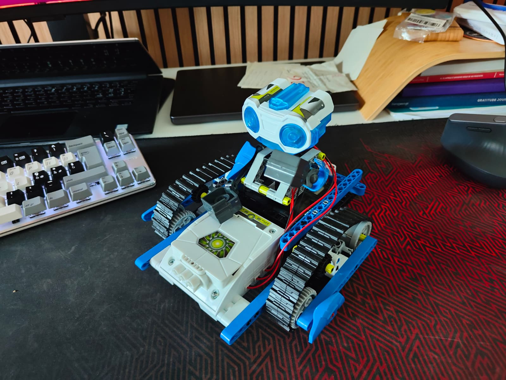
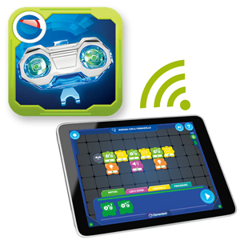
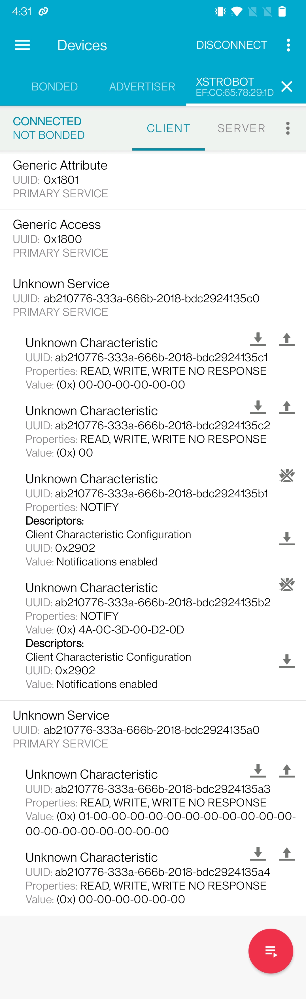
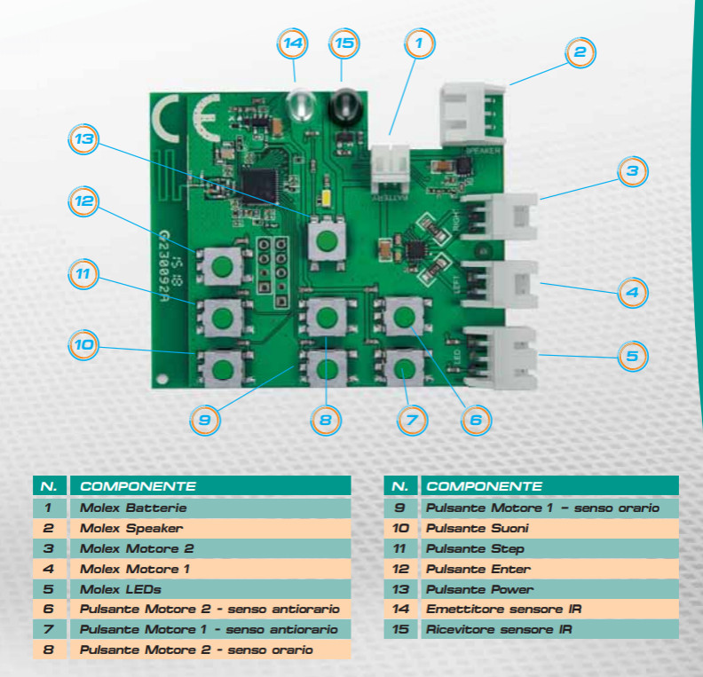

## Introduction

A couple of weeks ago, I was wandering in a second-hand market near my house, and found a brand new Clementoni Robot: ["Scienza & Gioco - Robomaker"](https://clementoni.zendesk.com/hc/it/articles/7610660922897-Scienza-Gioco-Robomaker-19132), product number `19132`. It's a classic DIY robot that kids (8+) can build, helped by an adult. The robot was released around 2018ish and it's part of Clementoni's STEM line. Here's the 

The robot can be guided using on-board physical buttons or via Bluetooth (Low Energy) using a mobile app called [Robomaker Start](https://play.google.com/store/apps/details?id=it.clementoni.robomakerstart). At first I thought I'd wait for my kid to be 8 years old, but curiosity won, and here we are.

The robot has 3 building variants from the easiest to the hardest:
- X1-Drawer: can draw using a real pencil
- X2-Elevator: can simulate a hand shake or elevate and transport tiny objects
- X3-Analyzer: can throw objects away from a table, or can follow a race track

Here you can find the official manuals (only in italian unfortunately):
- <a href="/blog/0026-reverse-engineer-clementoni-robomaker-start/manual-main-it.pdf" target="_blank" rel="noopener">the main manual</a> with some theory and basic instructions on how to use the robot and the mobile app
- <a href="/blog/0026-reverse-engineer-clementoni-robomaker-start/manual-x1-drawer-it.pdf" target="_blank" rel="noopener">the x1-drawer instruction manual</a>
- <a href="/blog/0026-reverse-engineer-clementoni-robomaker-start/manual-x2-elevator-it.pdf" target="_blank" rel="noopener">the x2-elevator instruction manual</a>
- <a href="/blog/0026-reverse-engineer-clementoni-robomaker-start/manual-x3-analyzer-it.pdf" target="_blank" rel="noopener">the x3-analyzer instruction manual</a>

Once you built your preferred variant, you can use its mobile app to control it: you can either use a predefined sequence of commands, or build your own. The app acts like a real laboratory to assemble and program robots.

The robot is also equipped with a tiny speaker, and can play sounds.... YES, PLAY SOUNDS. And as every other geek out there, the first thing I thought is "can I make it play the imperial march from Star Wars?".

The app doesn't allow you to upload custom sounds, so... time to open my IDE.

## The reconnaissance

Robots, Bluetooth (LE), speakers, are all unknown to me. So to start off, I installed [nRF Connect](https://play.google.com/store/apps/details?id=no.nordicsemi.android.mcp) on a test phone, turned on the robot and started analyzing its Bluetooth server.

As you can see from the screenshot below, the robot exposes two main services and a bunch of characteristics. All of them are predefined UUIDs with the same prefix: `ab210776-333a-666b-2018-bdc2924135XX`. XX is the discriminator:

- services
  - `c0`: used to control motors, LEDs and get live notifications from the robot
  - `a0`: used to send Audio clips (the one we are looking for)
- characteristics
  - `c1`: drives the 2 motors
  - `c2`: turns eyes LEDs on and off
  - `b1`: used to receive notifications when physical buttons are pushed on the robot (despite the prefix, it lives under the `c0` service)
  - `b2`: used to receive live notifications from the robot sensors (same here, under `c0`)
  - `a3`: plays sounds on the speaker 
  - `a4`: not really sure yet `¯\_(ツ)_/¯`

nRF Connect by itself didn't give me all the above information, but the characteristics descriptions, expected values and so on gave me a huge hint, for when I started sniffing actual Bluetooth traffic between the test phone and the robot.

## The sniffing

There are different ways to sniff Bluetooth traffic. I used [Wireshark](https://www.wireshark.org/) to intercept the Bluetooth traffic the phone was logging on a file. In practice you need to:
- enable Bluetooth HCI snoop log on your phone (it requires Developer Options to be enabled)
- install Wireshark with its extensions
- Find the extcap capture interface name by running `androiddump --extcap-interfaces` inside your shell
- run `wireshark -k -i android-bluetooth-btsnoop-net-XXXXXXXX` to start capturing the logged traffic (XXXXXXXX is the phone ID that you can get from `adb devices`)

Et voilà, you should be able to observe almost everything that is transmitted between the phone and the robot. From this point, it's all about firing a command from the official app, analyzing the traffic (handles used, values passed/received, any command sequences) and taking notes. We need to replicate all you see in Wireshark using custom code.

## The programming

My main machine has Linux on it. The app needs to go through `BlueZ`, the standard Bluetooth stack that ships with Linux, using a system messaging protocol called `D-Bus`.

I decided to start with a tiny .NET console app (no mobile for now, just to reduce the amount of things that can go wrong) and the SuessLabs's [Linux.Bluetooth](https://github.com/SuessLabs/Linux.Bluetooth) nuget package. Their README is pretty self-explanatory, so I won't dig into the details, but to start sending payloads to the robot via Bluetooth (LE) you basically need to:
- get the BLE adapter
- start discovering devices
- find a device named `XSTROBOT` (casing might not match)
- connect to the device
- wait for services and characteristics to be resolved
- pick the right characteristic
- start sending commands

### LEDs

To start simple, I decided to turn ON and OFF the robot's LEDs. As I mentioned before the characteristic driving the LEDs is the one ending with `c2`, which on hardware corresponds to the handle `0x0010`. In Wireshark I could only see the handle, then I had to guess the right characteristic by trial and error.

The handle was expecting a WRITE command with 1 byte payload to drive the 2 LEDs with the following values

- Both ON: 0x13
- One at a time: 0x11 or 0x12
- Both OFF: 0x10

### Motors

Motors raised the complexity bar by a fraction. The characteristic ends with `c1` and it corresponds to the handle `0x000E`. The write command needs to pass a payload formed by 6 bytes: 4 bytes (2 for each motor) are used to establish the direction, while the remaining 2 bytes are just fixed delimiters (`0xFA`).

The format is the following: `XXXX FA XXXX FA`. XXXX can be:
- `01FF` => move forward
- `02FF` => move backwards
- `0000` => stop

The motors will keep moving until you set `0000` again.

### Notifications

I tried to play a bit with the notification characteristics. The `b1`, triggered when physical buttons are pushed on the robot, was easier to parse because it just returns 1 byte for each pressed button as follows:
- `0x01`  => Motor1 forward
- `0x02`  => Motor1 backward
- `0x04`  => Motor2 forward
- `0x08`  => Motor2 backward
- `0x64` => E (Enter)
- `0x16` => ST (Step)
- `0x32` => S (Sound)

The `b2` was a bit trickier because it returns the values (6 bytes) of the robot sensors. I didn't dig into it, but if you put your finger on the robot's photodiode, some of the bytes definitely change value over time.

### Audio

I've learned the hard way that a sound file isn't ready to be sent over bluetooth like this: it has to shrink first.
You can't just beam an MP3 or a WAV file at this toy. This robot's tiny brain expects audio in a very specific, very compact format, and you can only drop a handful of bytes in at a time. So before anything goes out over the air, the app puts the sound through two transformations:

1. **Decode and downsample**: the bundled clips get converted (using `ffmpeg`) into raw, uncompressed audio at a very low quality: 4000 samples per second, mono. After A LOT of tries, this seems to be what the robot's hardware can actually digest. The audio is also normalized to a consistent loudness, since there's no volume knob on the wire.

2. **Compress into ADPCM**: Even downsampled, raw audio is still too big to trickle through efficiently, so it gets compressed using a scheme called `ADPCM` that, instead of storing each sound sample in full, stores how each sample differs from the one before it, and packs two samples into a single byte. It's a decades-old, very lightweight codec, exactly the kind of thing you'd choose for a cheap toy's cheap chip.

Then, as observed from Wireshark, we first need to put the robot in "Waiting for Audio" by sending the `0x14` byte on the LED's handle (I'm not sure why `¯\_(ツ)_/¯` ). After that we can send the audio data. And in the end we need to send the `0x10` byte again on the LED's handle: the same byte used to turn off both LEDs. That makes it tricky, if not impossible, to have blinking LEDs while playing a sound (the sound might just stop, I haven't tested it).

The audio payload needs to be sent in chunks of 20 bytes, and there needs to be a delay between one chunk and another, otherwise the result would be a crackling noise. The robot probably has an internal buffer with limited consuming speed. The delay has been set heuristically, based on what I could see on Wireshark.

## Conclusions

After a couple of afternoons spent tweaking with the robot, I managed to build a tiny UI, using AvaloniaUI, to connect to the robot and execute simple command sequences, and of course, play custom audio clips such as the Star Wars imperial march. The result is far from excellent compared to the built-in audio clips, but it's enough for now.

Here's a small video of the robot playing the imperial march (just refresh the page is you see `No video supported format and MIME type found`):

<video src="/blog/0026-reverse-engineer-clementoni-robomaker-start/imperial-march.mp4" controls></video>

All in all, it's been a fantastic adventure. I've never played with Bluetooth before, and I see it can be quite complex to operate with it; but that doesn't make it less fun. Let me know if you're interested in the source code of the AvaloniaUI app.

The next step might be to hop on the robot PCB, hook a USB-to-TTL converter to the `UART` interface (I can already see a couple of good candidates) and see what's going on near the bare metal. Maybe we can find some more details to make the custom audio clips sound better.

